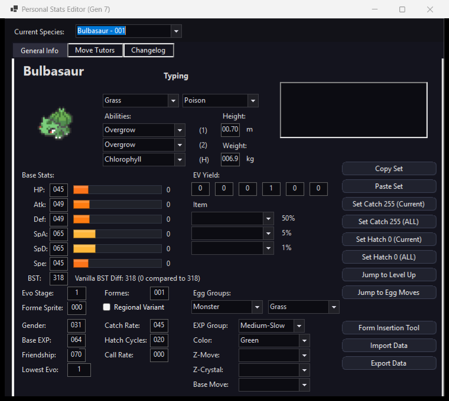

<!-- markdownlint-disable MD033 -->
<p align="center">
  
</p>

<h1 align="center">pk3DS (But Extremely Catered Towards USUM)</h1>
<h2 align="center">(Yes, it works with the Expansion Mod!).</h2>

<p align="center">
  
</p>
<!-- markdownlint-enable MD033 -->

**pk3DS (But Extremely Catered Towards USUM)** is a customized fork of pk3DS designed to give Ultra Sun & Ultra Moon ROM hackers and randomizer fans the best possible experience they can have. It includes all the features from the base pk3DS, but adds many new features and improvements specifically for USUM.

---

## What's Possible With This Fork?

Here is a look at what you can do across the program:

### RomFS & Game Data Editors

- **Personal Stats**: stats, types, abilities, items, egg groups and more, with a running BST difference against the original game and quick jumps to Level Up and Egg Moves.
- **Trainers**: full team editing with EVs, IVs, natures and held items; import and export teams in Showdown format and keep sets in a storage list.
- **Level Up Moves**: add, remove and reorder moves; dump every learnset to a text file and import it back (text, Showdown, JSON or TSV), with a changelog against the original game.
- **TM Editor**: swap or replace TM moves; learnsets follow the move, so every Pokémon that learned it still does.
- **Also included**: wild and static encounters, starters and gifts, marts, move and item stats, evolutions, Mega Evolutions, egg moves, type chart, shiny rate, Battle Tree and Battle Royal, game and story text, title screen, icons and model scale.
- **Form and species insertion**: add new forms (vanilla and Expansion Mod), or new species cloned from an existing one (Expansion Mod).

### Modern Mechanics & Patch Packages

- **More than 70 patch packages** that add newer-generation mechanics to USUM, for example Booster Energy, Covert Cloak, Loaded Dice, Throat Spray and Utility Umbrella; abilities such as Orichalcum Pulse, Purifying Salt, Sharpness, Zero to Hero and the Ruin abilities; and mechanics such as Snow replacing Hail, and Frostbite.
- **IPS patches** for Ultra Sun and Ultra Moon (EXP multipliers, catchable trainer Pokémon and more).
- **Passive abilities** (Rom Nueva +): edit species and trainer passives on ROMs that already include that mod. Turn it on under Options.

### Enhanced Universal Randomizer

- **Competitive trainers**: level-aware EV spreads, damage- and coverage-based move choices, and team synergy, with tunable weights.
- **Learnsets**: every learnset mode is honoured, and a learnset's first move never duplicates another slot.
- **TMs**: optionally expand the TM list, and give trainers TM moves.
- Settings save and load with the rest of the randomizer options.

### Pokémon Uhuru Gift Support

pk3DS detects the Korean **Pokémon Uhuru Gift v16.0.3** expansion and adapts to it:

- Trainer difficulty blocks (Normal to Inferno), the Normal/Hard static encounter picker, and Battle Facility pools.
- An English text package for the Uhuru-only text.
- Editors that would overwrite Uhuru's own code changes refuse to save instead of breaking the game.

### Research Center & CRO Expander 4.0

- **Research Center**: install patch packages, with code placed in free space that is checked before anything is written.
- **CRO Expander 4.0**: grow CRO modules to make room for new code.
- **Mod-folder export**: write your changes as a LayeredFS folder for Azahar or Luma, instead of rebuilding the whole ROM.

### Visual Themes & Modern UI

- **4 Custom Themes**: Switch effortlessly between Dark Mode, Gray, Classic Light, and Galaxy Purple.
- **Interactive Mascot Sprites**: Clickable companion sprites featuring various iconic legendaries in the sidebar.
- **Built-in Sprite Packs**: High-quality sprites for modern items, custom forms, and elemental badges.

---

## Installation & Usage

1. Download the latest release from the [Releases page](https://github.com/adhfult/pk3DS-but-mostly-for-USUM/releases) or the [Project Pokémon forum thread](https://projectpokemon.org/home/forums/topic/34377-pk3ds-pok%C3%A9mon-3ds-rom-editor-and-randomizer/).
2. Extract the folder onto your computer.
3. Dump your decrypted Pokémon Ultra Sun or Ultra Moon ROM (RomFS and ExeFS).
4. Run `pk3DS.WinForms.exe` and select **File → Open** to choose your game directory.

---

## Building from Source

### Prerequisites

- [.NET 8.0 SDK](https://dotnet.microsoft.com/download/dotnet/8.0)
- Visual Studio 2022 or the .NET CLI

### Build Steps

```bash
git clone https://github.com/adhfult/pk3DS-but-mostly-for-USUM.git
cd pk3DS-but-mostly-for-USUM
dotnet build pk3DS.sln --configuration Release
```

The output will be located in `pk3DS.WinForms/bin/Release/net8.0-windows/`.

---

## Support & Credits

If you run into any bugs or have feedback, feel free to open an issue or reach out through the community threads:

- **Kaphotics** — For creating pk3DS and providing the foundation for 3DS Pokémon hacking.
- **ABZB** — For extensive ARM assembly reverse engineering, CRO research, and function table documentation.
- **Stracker** — For the [OWSE Overworld Script Editor](https://github.com/Strackeror/pk3DS/releases/tag/stracker-1.0).
- **Smogon & Pokémon Showdown!** — For team formatting standards, sprite assets, etc.
- **3DS ROM Hacking Discord** - My guys, love you all for the support and I'm glad this tool can finally come out.
